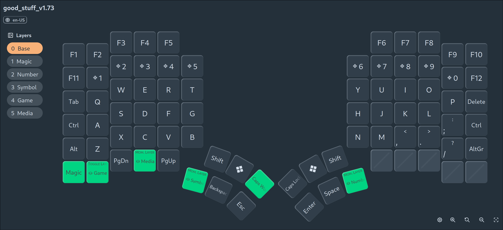
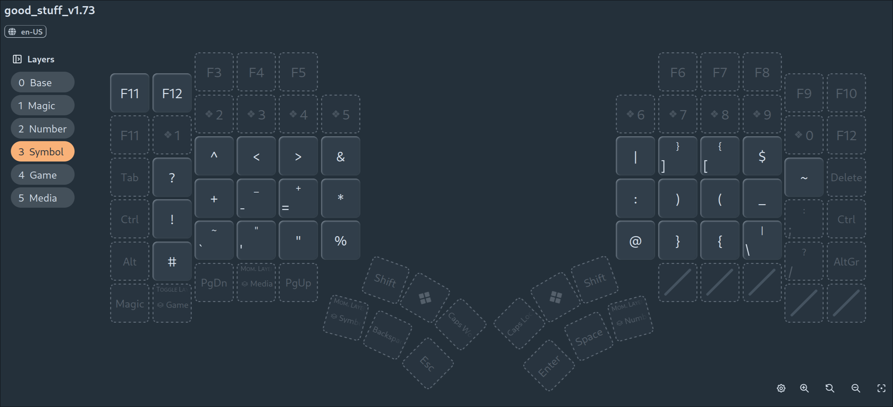
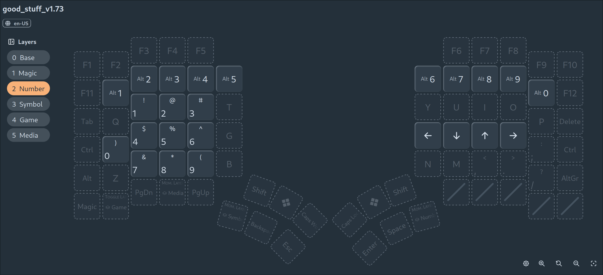

## My keyboard journey

Starting with my journey with programming, I have developed a hobby in mechanical keyboards.

Over the years, I have used quite a few keyboards. Here's a subset of them that I would recommend.

- [HHKB Hybrid Type-S](https://hhkeyboard.us/hhkb/pro-hybrid-type-s/white-stamped):
  HHKB has my favorite sound and typing feedback. The special tactile feeling and silence are unique to its 'Topre' switch, which no mechanical switches come close to in my opinion. It also has a very special look, a combination of zen and retro, which I personally really like.

- [Neo Ergo](https://www.qwertykeys.com/products/neo-ergo?variant=46687010521331):
  My very last 'high-end' keyboard and my first 'ergonomic' keyboard. CNC aluminum gives it a very premium feeling, sound and weight. I pair it with a tactile switch called the MMD Prince switch, and it's working perfectly.
  It also supports tri-mode connections.

- [Cornix](https://www.ozokeyboards.com/products/cornix-split-low-profile-split-ergonomic-keyboard):
  My first split + ortholinear keyboard. I got it after I got my first job as an engineer. It's also made of aluminum but is surprisingly lightweight and is by far the most flexible keyboard to carry around. It only takes up the space of a large-sized phone altogether and can even easily fit in my pocket.

> HHKB can be customized through its own software with very limited features, or through Kanata or Karabiner with way more features. Neo Ergo can be customized through VIA on the web, and Cornix can be customized through Vial.

> Neo Ergo took almost no time to adapt to. HHKB took some time to adapt to since it has a different keymap (Ctrl on Caps Lock) and hides its arrow keys, and Cornix took the most time because of the need to adjust to at least two new layers for numbers and symbols.

## Ortholinear keyboards

After trying out a variety of different normal or ortholinear or split keyboards, I decided that I wanted a split ortholinear, ergonomic, highly customizable keyboard. And I want either an easy-to-assemble or a pre-built keyboard that I can start using immediately -- simply because I might need to carry it around for my hybrid work, and custom builds give me a feeling of not being robust enough for day-to-day carrying. So 3D-printed keyboards are off my list. Eventually, I find myself targeting the Kinesis Advantage360, the Moonlander and the Glove80.

I eventually go with Glove80 after watching endless videos and posts on YouTube and Reddit, since it's the most portable one and it's concave. That being said, all of the keyboards that I mentioned are great keyboards.



## Symbol layer

The philosophy of designing a symbol layer is not exclusive to Glove80 or any keyboard. In fact, I used a number and symbol layer on all of the keyboards that I mentioned above, including built-in keyboards through the almighty powerful Karabiner-Elements.

The purpose for me to build a number layer and a symbol layer is very simple. It allows my fingers to travel less when I'm typing and makes typing easier, causing less pain to my wrists and even fewer typos when typing combinations of letters and symbols. I find reaching for the number row kind of hard, and it causes typos sometimes. I could never figure out the right fingers to use on each number and symbol.

I got my inspiration for a keyboard layer from [this post here](https://getreuer.info/posts/keyboards/symbol-layer/index.html) by Pascal Getreuer.

The TL;DR for that is that common combinations of symbols like !==, ===, +=, () => {} (you can tell I code JavaScript and TypeScript a lot) should be easier to type. And inward typing, meaning going from pinky to index, is more comfortable than the other way around (i.e., typing ;lkj should feel better than jkl;).

On top of that, my theory is that the index and middle fingers should control more frequent symbols, and the ring and little fingers should control less frequent ones.
Here's my symbol layer.



In text, it is:

```text
? ^ < > &    | ] [ $ ~
! + - = *    : ) ( _ ;
# ` ` " %    @ } { /
```

Some combos that are really nice to type in my config:

```text
-= += *= != () [] {} <> -> => ::
```

And most importantly, `() => {};`

Also, it's easy to adapt to (in my opinion):
All brackets are in the same row. () is the most frequent, so it's in the home row. Then [] and {} are also in very handy positions. : is also in the home row since I use Vim a lot and TypeScript uses it for types. The same goes for ;
_ is also in the home row for use in some snake-cased languages.

And on the left hand, we've got all the operators that are used very frequently in any language, such as = ! and *

## Number layer



The number layer is relatively simple. I mapped the spaces near the left-hand home row in:

```text
  1 2 3
0 4 5 6
  7 8 9
```

A more intuitive way for some people might be to reverse it to match how it looks on a full-size keyboard.
However, I've never used those keyboards, and I find numbers in ascending order make a little bit more sense to me. Placing 0 on the home row makes accessing it take less effort.
